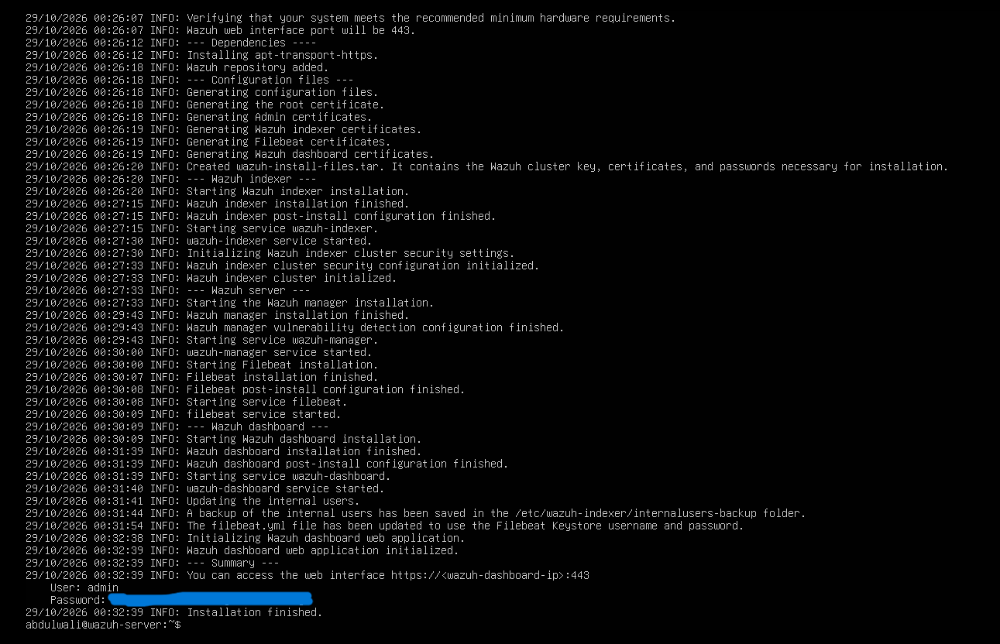
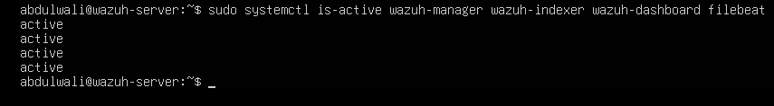
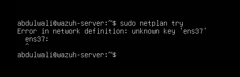
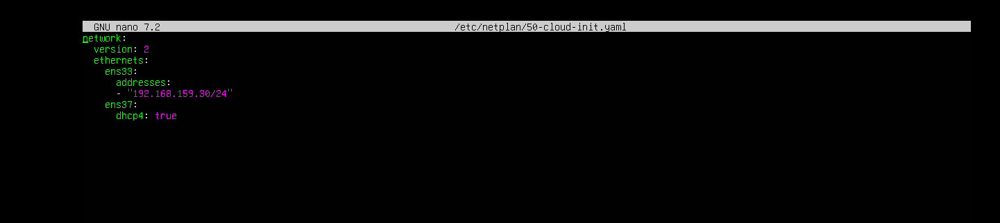
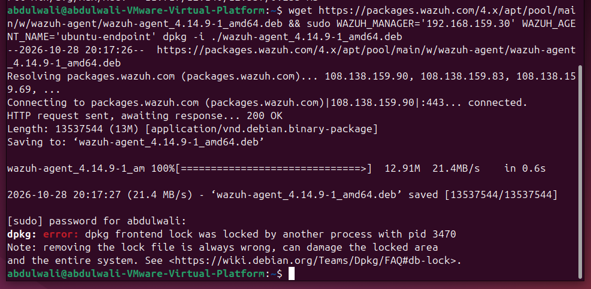
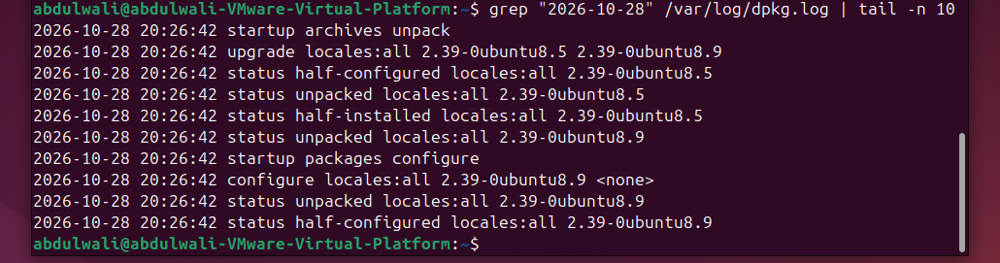
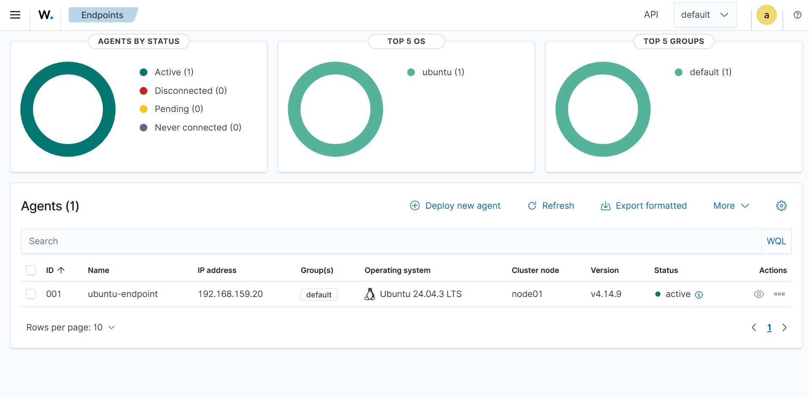
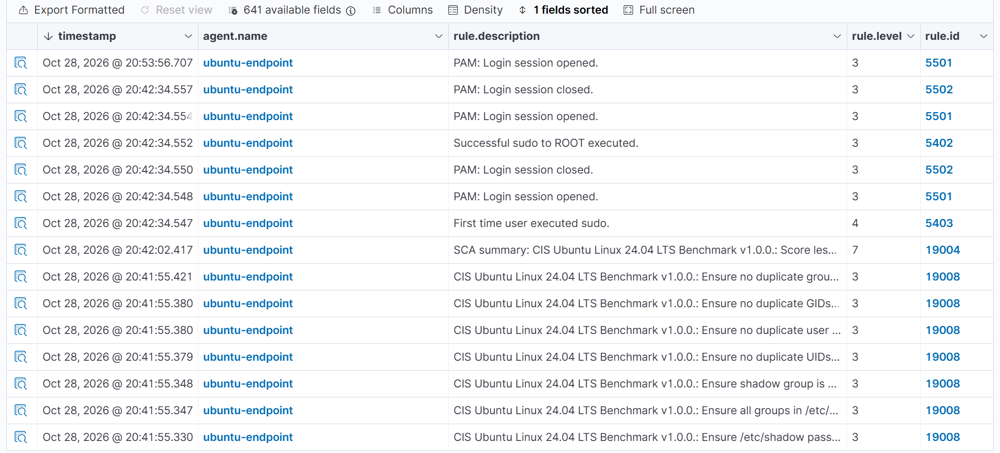

# Milestone 2 – Wazuh Server and Endpoint Setup

## Overview

For Milestone 2, I set up my Wazuh server and connected an Ubuntu endpoint to it for security monitoring. The goal was to get both virtual machines communicating, install the Wazuh agent, and confirm that the server could collect security events from the endpoint.

I used VMware Workstation Pro and configured both machines on an isolated host-only network (VMnet1).

## Lab Environment

| System | Operating System | IP Address | Purpose |
|---|---|---|---|
| Wazuh Server | Ubuntu Server 24.04.4 LTS | 192.168.159.30 | Security monitoring and log management |
| Ubuntu Endpoint | Ubuntu Desktop 24.04.3 LTS | 192.168.159.20 | Monitored machine running the Wazuh agent |

**Tools Used:** VMware Workstation Pro, Wazuh 4.14.9, Ubuntu Linux, Netplan, systemctl, and dpkg.

## Wazuh Server Installation

I configured the Wazuh server virtual machine with 8 GB of RAM, 4 CPU cores, and a 50 GB virtual disk.

I installed the Wazuh components, including the manager, indexer, dashboard, and Filebeat. After installation, I verified that the services were running and accessed the Wazuh dashboard through my Windows host.

## Network Configuration

Both virtual machines were assigned static IP addresses on VMware's VMnet1 host-only network.

I temporarily added a NAT network adapter to provide internet access for downloading and installing software. Once the installation was complete, I removed the temporary adapter to return the lab to its isolated network configuration.

### Troubleshooting: Netplan Configuration Error

While configuring the additional network adapter, I encountered an error because the `ens37` interface was incorrectly indented in my Netplan YAML configuration.

Netplan returned the error `unknown key 'ens37'`.

I reviewed the configuration file and corrected the indentation so both interfaces were properly listed under `ethernets`. After applying the corrected configuration, I verified that both interfaces were active and the temporary NAT connection provided internet access.

## Ubuntu Endpoint and Wazuh Agent Setup

After configuring the Ubuntu endpoint, I installed the Wazuh agent and connected it to the Wazuh manager at `192.168.159.30`.

The endpoint was registered as `ubuntu-endpoint` with agent ID `001`.

### Troubleshooting: Package Manager Lock

During the agent installation, I received a `dpkg` lock error because Ubuntu's automatic update service was already using the package manager.

Instead of forcing the installation, I checked the running processes and reviewed the package manager logs. The logs showed that Ubuntu was actively installing updates.

I waited for the update process to finish, confirmed that the package manager lock was released, and then successfully installed the Wazuh agent.

## Agent Connection Verification

After installing the agent, I enabled and started the Wazuh agent service.

I then opened the Wazuh dashboard and confirmed that the Ubuntu endpoint appeared with an **active** connection status.

I also removed the endpoint's temporary NAT adapter and verified that the agent remained connected through the isolated VMnet1 network.

## Security Event Monitoring

I used the Wazuh Threat Hunting dashboard to verify that the server was receiving security events from the Ubuntu endpoint.

The dashboard displayed approximately 288 alerts, including:

- Successful sudo commands
- Login sessions opening and closing
- System security configuration checks
- CIS Ubuntu Linux benchmark assessment events

These events confirmed that the Wazuh agent was sending security information to the server and that Wazuh was processing the collected logs.

The alerts were generated during normal setup and configuration activities, rather than a simulated attack.

## Results

By the end of Milestone 2, I had successfully:

- Installed and configured the Wazuh server.
- Configured static IP addresses for the server and Ubuntu endpoint.
- Installed and registered the Wazuh agent.
- Verified that the Ubuntu endpoint appeared as active in the dashboard.
- Confirmed that security events were being collected.
- Resolved Netplan configuration and package manager issues.
- Returned both virtual machines to the isolated host-only network.

This milestone gave me hands-on experience with Linux administration, network configuration, troubleshooting, and centralized security monitoring.

## Next Steps – Milestone 3

For Milestone 3, I plan to add a Kali Linux virtual machine to the isolated network and generate controlled security events against the Ubuntu endpoint.

I'll use Wazuh to monitor the activity, review the alerts, and understand how different security events are detected and recorded.
