# Milestone 3 – Attack Simulation and Security Event Generation

## Overview

For Milestone 3, I added Kali Linux to my Mini SOC lab and used it to generate security events against the Ubuntu endpoint. I ran Nmap scans to identify open ports and services, then tested failed SSH logins to create authentication events that Wazuh could collect.

All three VMs were configured on the isolated VMware VMnet1 host-only network.

## Lab Environment

| System | IP Address | Purpose |
|---|---|---|
| Kali Linux | 192.168.159.10 | Attacker VM |
| Ubuntu Desktop | 192.168.159.20 | Monitored endpoint |
| Wazuh Server | 192.168.159.30 | Security monitoring server |

## 1. Kali Linux Network Configuration

I configured Kali with a static IP address of `192.168.159.10` using NetworkManager's `nmcli` command. This placed Kali on the same isolated network as the Ubuntu endpoint and Wazuh server.

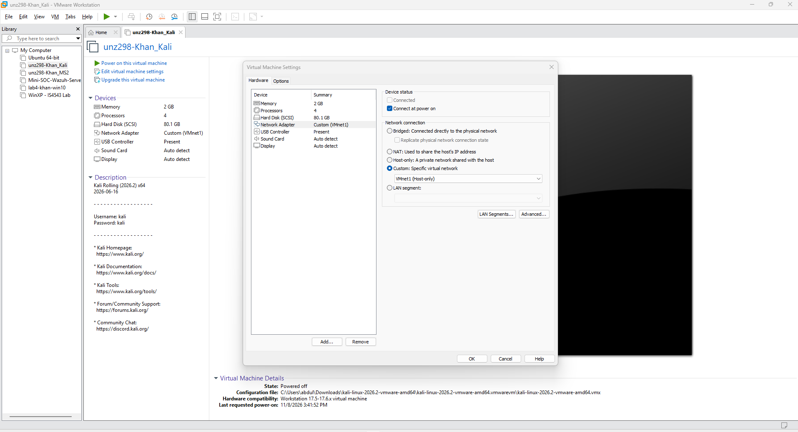

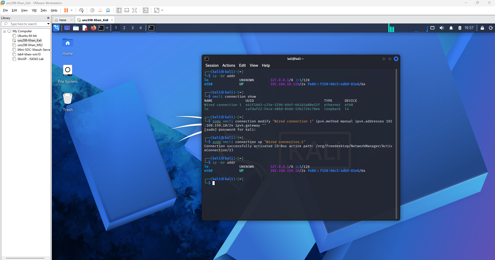

## 2. Ubuntu SSH Setup and Troubleshooting

Before testing SSH logins, I checked whether the Ubuntu endpoint had an SSH server installed. The `ssh.service` unit was missing, so I installed OpenSSH Server.

I temporarily added a NAT adapter to the Ubuntu VM to download the package. After confirming internet connectivity, I installed OpenSSH Server and started the SSH service.

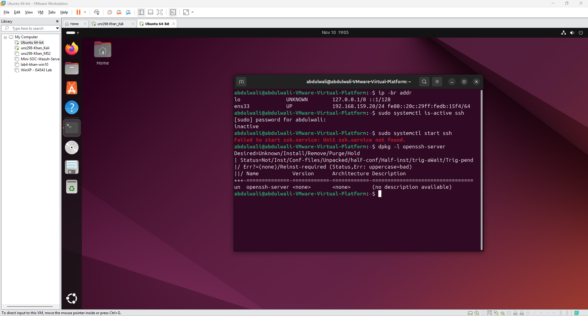

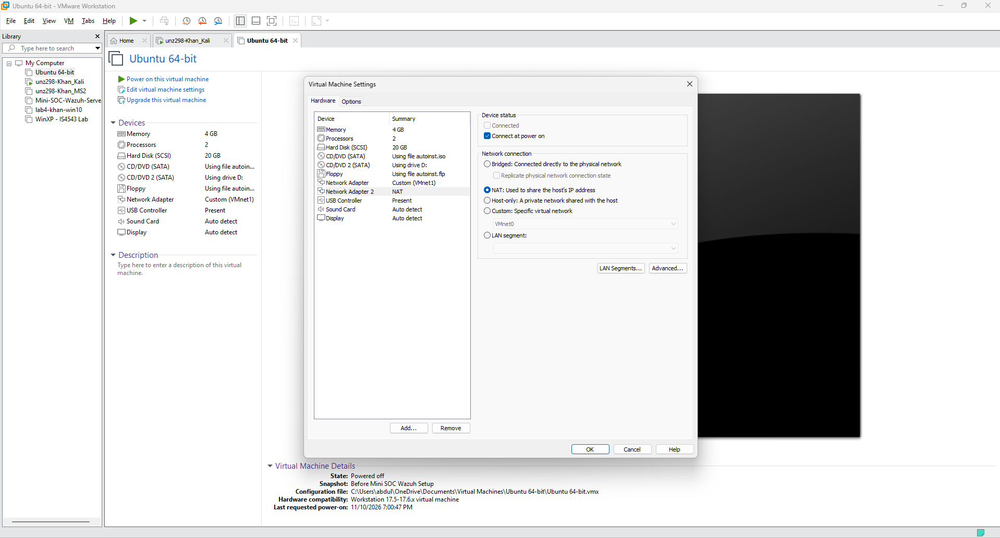

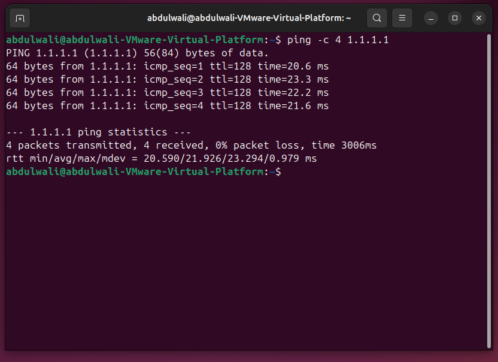

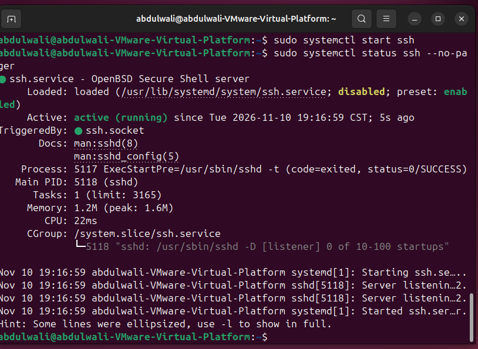

Once the installation was complete, I removed the temporary NAT adapter to restore the isolated network. I also checked that SSH was listening on port 22 after restarting the VM.

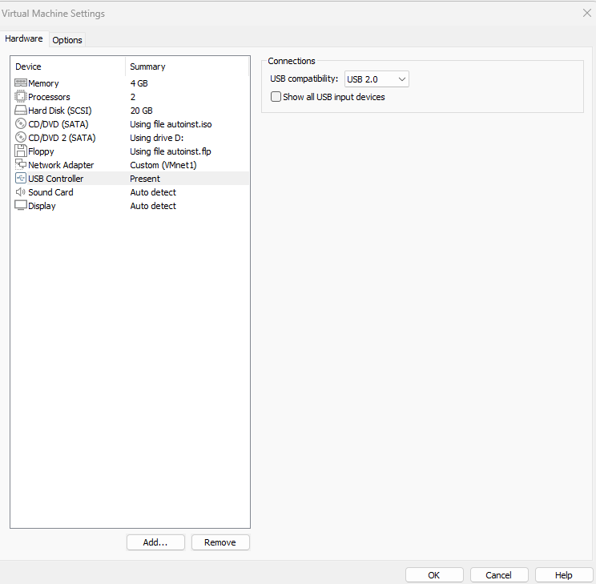

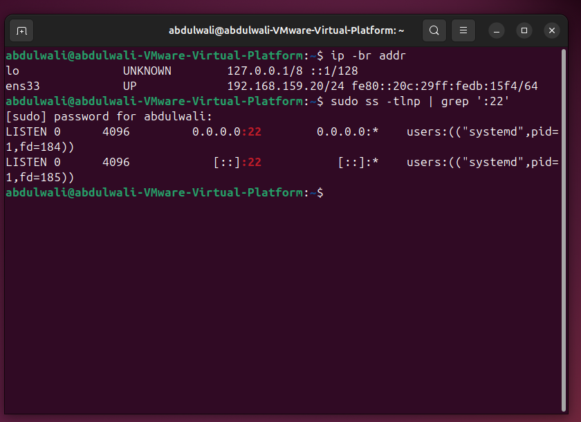

## 3. Connectivity Testing

From Kali, I pinged the Ubuntu endpoint at `192.168.159.20`. All four packets were received, confirming that Kali could reach the endpoint over VMnet1.

```bash
ping -c 4 192.168.159.20
```

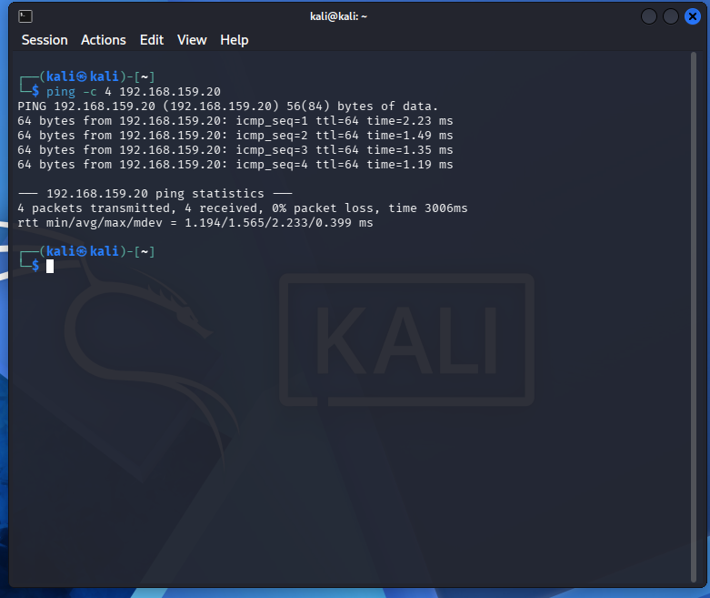

## 4. Nmap Scanning

I used Nmap to scan the Ubuntu endpoint and identify available services.

First, I ran a TCP SYN scan:

```bash
sudo nmap -sS 192.168.159.20
```

The scan found port 22 open for SSH. The other 999 scanned TCP ports were closed.

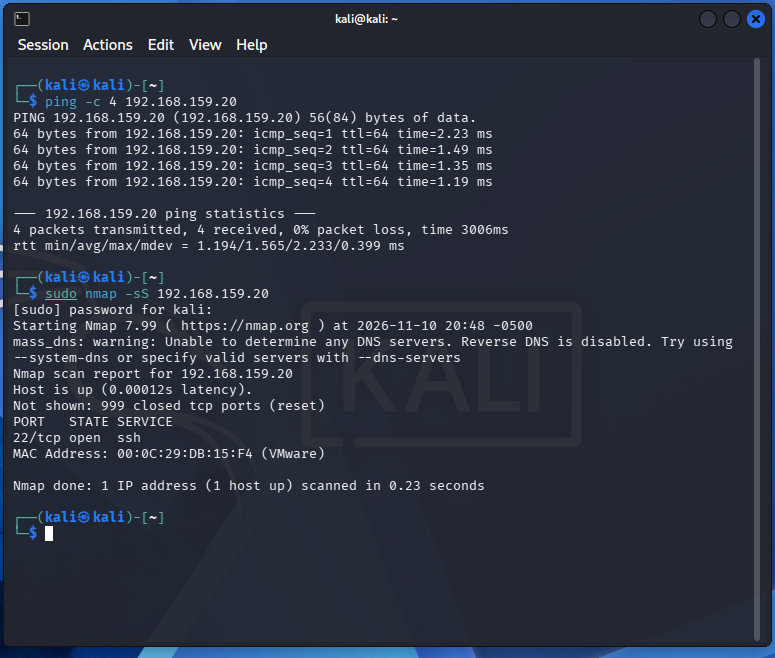

Next, I ran a version detection scan against port 22:

```bash
nmap -sV -p 22 -n 192.168.159.20
```

Nmap identified OpenSSH 9.6p1 running on the Ubuntu endpoint.

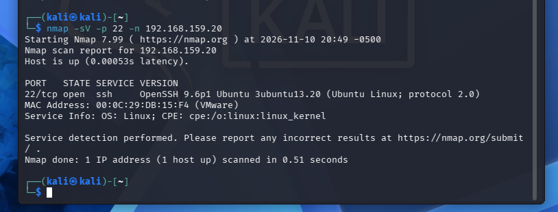

## 5. Failed SSH Login Testing

I tested SSH authentication by connecting from Kali to the Ubuntu endpoint using the `abdulwali` account and intentionally entering an incorrect password.

The connection was rejected with a permission-denied message.

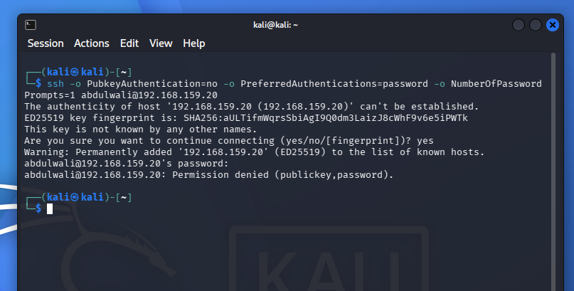

I then checked the Ubuntu endpoint's SSH journal. The logs showed the authentication failure and identified the source as Kali's IP address, `192.168.159.10`.

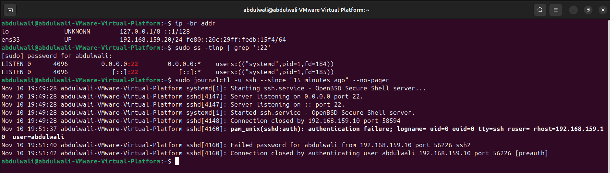

## 6. Wazuh Agent Reconnection

While checking the Wazuh agent, I noticed that it couldn't connect to the server because the Wazuh server VM was powered off.

I powered the server back on and confirmed that its services were active. The Ubuntu agent then reconnected to the Wazuh manager at `192.168.159.30`.

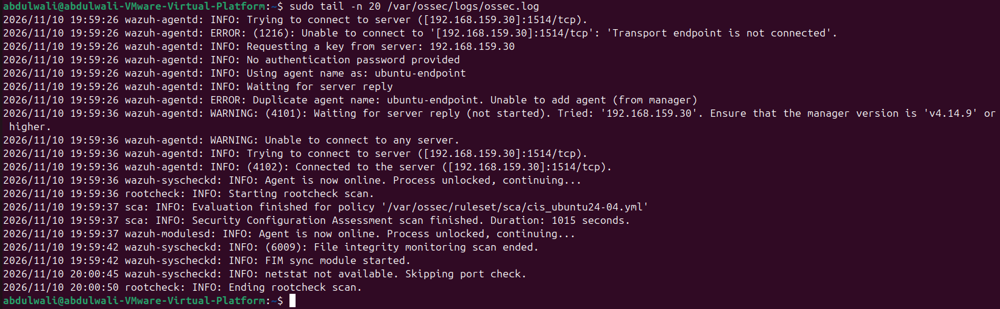

## 7. Multiple Failed Login Attempts

With the Wazuh server running, I generated five controlled failed SSH login attempts from Kali against the Ubuntu endpoint.

I used a Bash loop to repeat the SSH connection, entering an incorrect password each time.

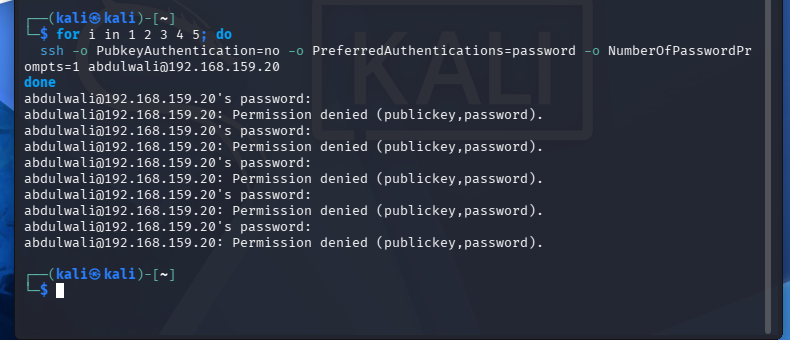

I checked the Ubuntu endpoint's SSH logs afterward and confirmed that all five failed password attempts were recorded from `192.168.159.10`.

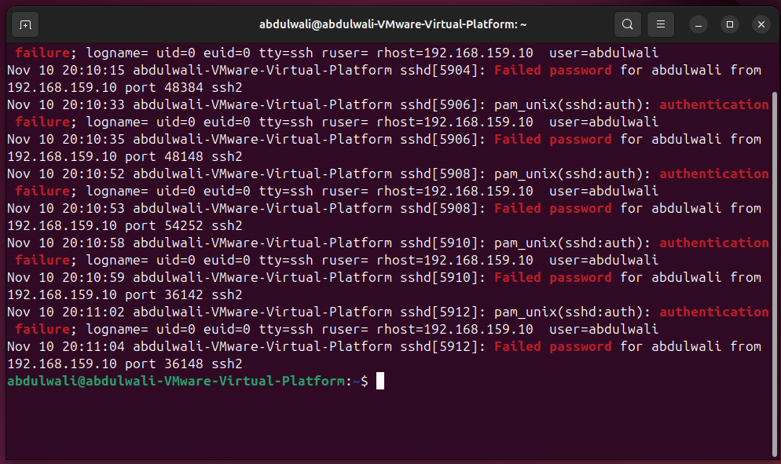

## Results

By the end of Milestone 3, I had:

- Configured Kali Linux on the isolated VMnet1 network
- Installed and configured OpenSSH Server on the Ubuntu endpoint
- Confirmed connectivity between Kali and Ubuntu
- Completed Nmap SYN and SSH version detection scans
- Generated and verified failed SSH authentication events
- Confirmed the Wazuh agent reconnected to the manager

## Next Steps

In Milestone 4, I'll review the events in the Wazuh dashboard to see which alerts were generated. I'll check the rule IDs, severity levels, source IP addresses, and other details, then compare the results with the baseline from Milestone 2.

## Tools Used

VMware Workstation Pro, Kali Linux, Ubuntu Desktop, Wazuh, Nmap, OpenSSH, NetworkManager, and Linux system logs.
