# Milestone 4 – Security Alert Analysis and Investigation

**Status:** Completed  
**Completion Date:** November 24, 2026

## Objective

The goal of this milestone was to investigate the security alerts generated during Milestone 3, identify the source and affected system, analyze the detection rules, and understand the capabilities and limitations of my Wazuh monitoring environment.

## Lab Environment

| System | IP Address | Purpose |
|---|---|---|
| Wazuh Server | 192.168.159.30 | Security monitoring and alert analysis |
| Ubuntu Endpoint | 192.168.159.20 | Monitored system |
| Kali Linux | 192.168.159.10 | Source of controlled security activity |

**Network:** VMware VMnet1 (Host-Only), 192.168.159.0/24

## 1. Verify Wazuh Services and Agent Connectivity

Before investigating the alerts, I verified that the Wazuh manager, indexer, dashboard, and Filebeat services were running.

```bash
sudo systemctl is-active wazuh-manager wazuh-indexer wazuh-dashboard filebeat
```

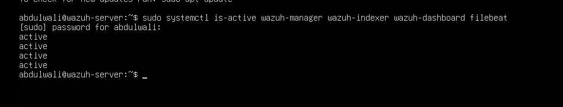

I also verified that the Ubuntu endpoint was connected to the Wazuh manager as agent 001.

```bash
sudo /var/ossec/bin/agent_control -l
```

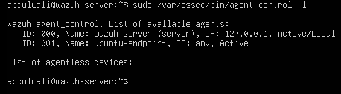

## 2. Network Troubleshooting

Initially, I could not access the Wazuh dashboard from my Windows host.

After troubleshooting, I discovered that VMware's VMnet1 network was configured for 192.168.19.0/24 instead of the Mini SOC subnet of 192.168.159.0/24.

I corrected the subnet configuration and repeated the ping test. All four packets were received successfully with 0% packet loss.

After restoring connectivity, I accessed the Wazuh dashboard and confirmed that one agent was active and no agents were disconnected.

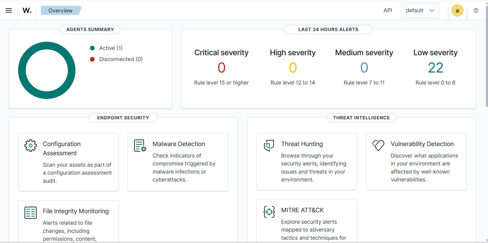

## 3. Historical Threat Hunting

Instead of repeating the attacks from Milestone 3, I investigated the original security events generated on November 10, 2026.

I expanded the Threat Hunting dashboard's time range to the last 30 days.

| Metric | Count |
|---|---:|
| Total alerts | 701 |
| Authentication failures | 16 |
| Successful authentications | 25 |
| Alerts at level 12 or above | 0 |

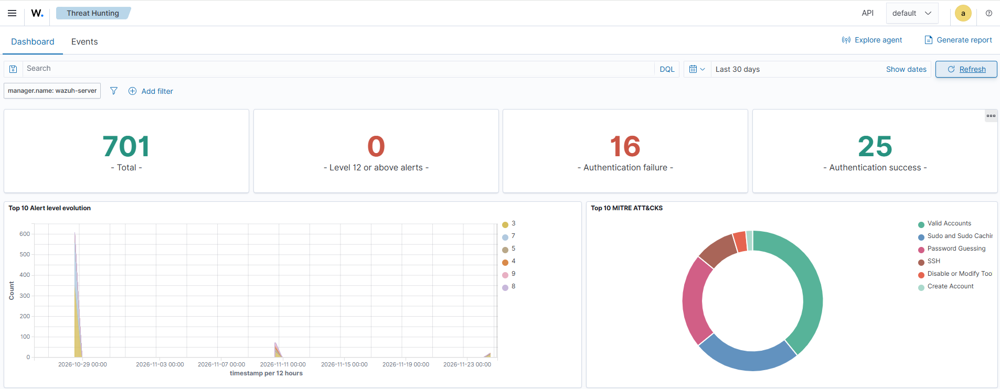

I reviewed the alert timeline to identify activity around the original testing period.

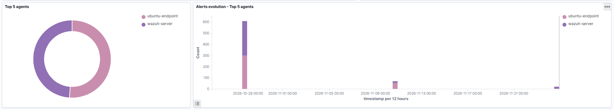

## 4. Filter Alerts by Source IP

I used the following DQL query to isolate security alerts associated with the Kali Linux machine:

```text
data.srcip: "192.168.159.10"
```

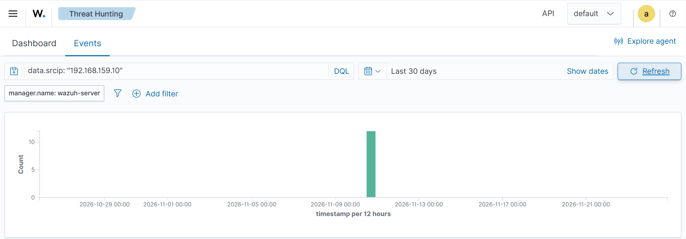

The search returned 12 alerts associated with the Ubuntu endpoint.

| Rule ID | Description | Level | Count |
|---|---|---:|---:|
| 5760 | sshd: authentication failed | 5 | 6 |
| 5503 | PAM: User login failed | 5 | 6 |
| **Total** | | | **12** |

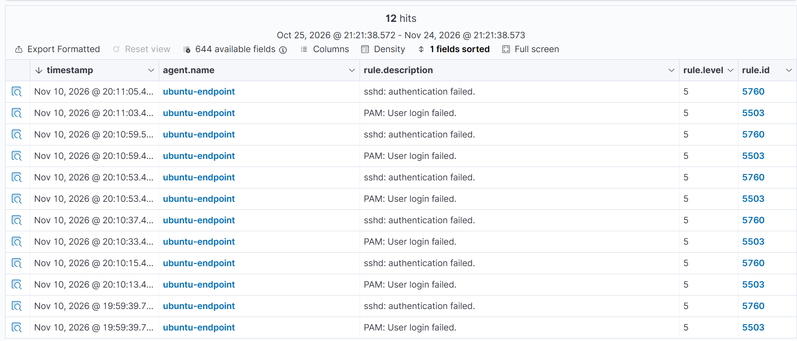

## 5. SSH Authentication Failure Investigation

I expanded an individual SSH authentication failure alert to examine its original log and extracted fields.

| Field | Value |
|---|---|
| Source IP | 192.168.159.10 |
| Affected endpoint | ubuntu-endpoint |
| Endpoint IP | 192.168.159.20 |
| Agent ID | 001 |
| Source port | 36148 |
| Decoder | sshd |
| Log source | journald |
| Rule ID | 5760 |
| Rule level | 5 |

The original log confirmed a failed SSH password attempt originating from Kali Linux.

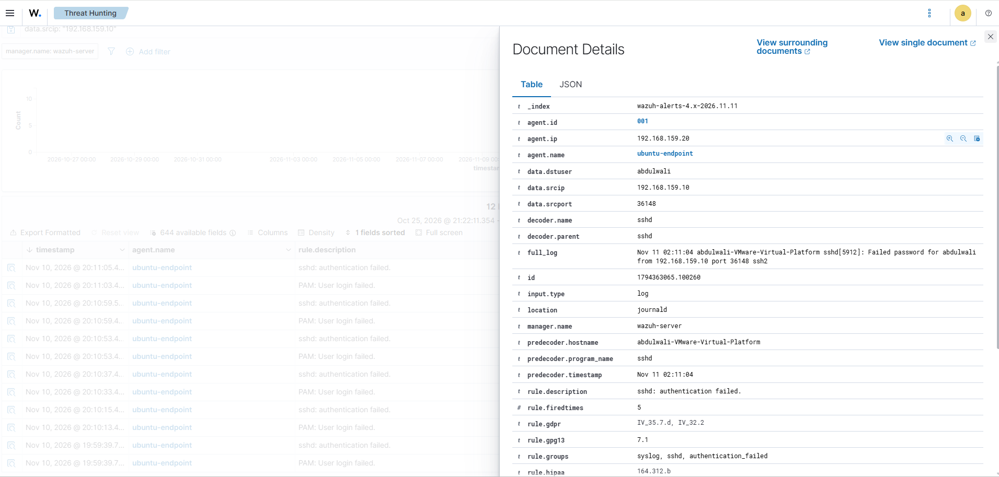

### MITRE ATT&CK Classification

| Technique ID | Technique | Tactic |
|---|---|---|
| T1110.001 | Password Guessing | Credential Access |
| T1021.004 | SSH | Lateral Movement |

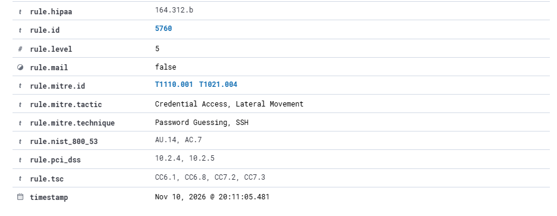

These classifications describe potential attacker behavior and do not indicate that unauthorized access or lateral movement was successful.

## 6. PAM Authentication Failure Investigation

I investigated a PAM authentication failure alert and compared it with the SSH alert.

Both alerts contained the same source IP, target username, affected endpoint, and SSH process ID of 5912. Their original log timestamps were approximately two seconds apart.

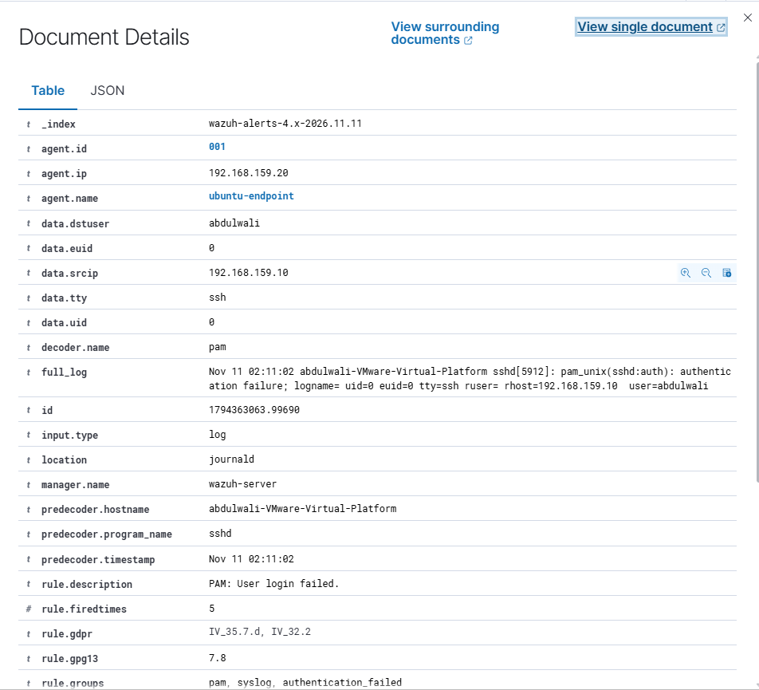

The PAM alert matched rule 5503 at severity level 5 and was mapped to Password Guessing (T1110.001) under Credential Access.

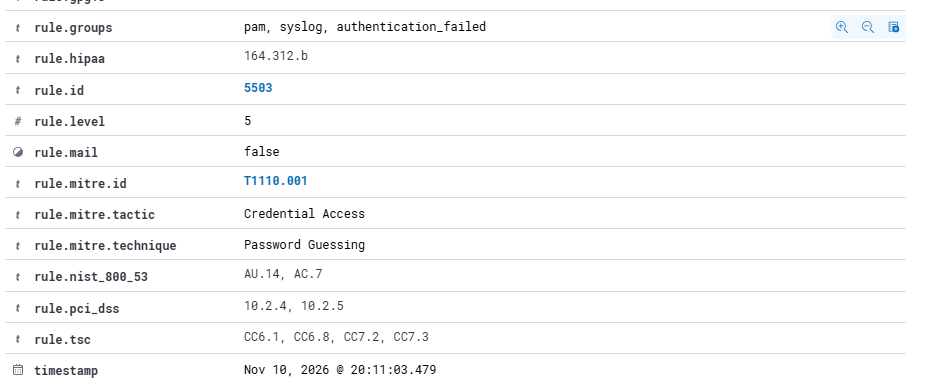

## 7. Alert Correlation

The six failed SSH login attempts from Milestone 3 resulted in 12 matching security alerts.

The matching process ID, source IP, username, endpoint, and timestamps provided strong evidence that the examined SSH and PAM alerts originated from the same authentication attempt.

This demonstrated that multiple alerts do not necessarily represent separate attacks. Security analysts must correlate related events to accurately understand the scope of suspicious activity.

No separate brute-force correlation alert appeared in the filtered results.

## 8. Nmap Detection Investigation

I investigated whether Wazuh generated alerts related to the Nmap scans performed during Milestone 3.

I used the following DQL query:

```text
agent.name: "ubuntu-endpoint" AND (rule.description: *scan* OR rule.description: *nmap*)
```

The search returned no matching results within the selected 30-day period.

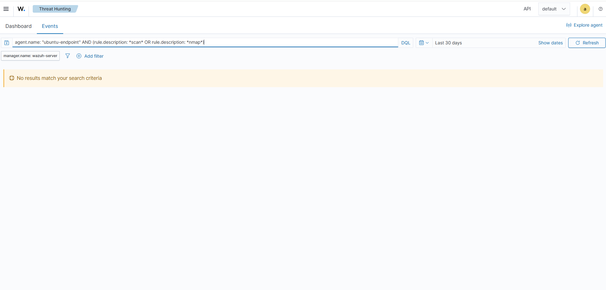

My current configuration primarily relies on endpoint logs rather than direct network traffic monitoring. This may limit visibility into network reconnaissance activity.

Additional network monitoring, such as integrating Suricata with Wazuh, could improve detection coverage.

## 9. Detection Results

| Security Activity | Result |
|---|---|
| Initial failed SSH login | Detected |
| Five additional failed SSH logins | Detected |
| PAM authentication failures | Detected |
| Brute-force correlation | No separate matching alert identified |
| Nmap SYN scan | No matching alert identified |
| Nmap version detection scan | No matching alert identified |

These results reflect the current lab configuration and the searches performed during this milestone.

## 10. Skills and Knowledge Gained

- Historical threat hunting
- DQL search and alert filtering
- Security log analysis
- SSH and PAM authentication monitoring
- Alert correlation
- Wazuh rule and severity analysis
- MITRE ATT&CK classification
- VMware network troubleshooting
- Identification of security monitoring limitations
- Understanding endpoint and network monitoring differences

## 11. Key Takeaways

This milestone helped me understand how a SIEM processes raw logs, extracts relevant information, and matches events to security detection rules.

I also learned that alert counts alone do not accurately represent the number of attack attempts. Correlating related events using timestamps, process IDs, and source information is important when investigating security incidents.

The investigation demonstrated that my current Wazuh configuration successfully detects SSH authentication failures while potentially having limited visibility into network reconnaissance.

## 12. Next Steps

During Milestone 5, I plan to:

- Repeat selected security tests to verify detection consistency.
- Investigate brute-force correlation alerts through additional controlled authentication tests.
- Explore options for improving network monitoring visibility.
- Evaluate the overall effectiveness and limitations of the Mini SOC.
- Organize and document the final project results.

## References

- [Wazuh Documentation](https://documentation.wazuh.com/)
- [Wazuh Ruleset Documentation](https://documentation.wazuh.com/current/user-manual/ruleset/index.html)
- [MITRE ATT&CK – Password Guessing (T1110.001)](https://attack.mitre.org/techniques/T1110/001/)
- [MITRE ATT&CK – SSH (T1021.004)](https://attack.mitre.org/techniques/T1021/004/)

---

[Back to Main Project](../README.md)
